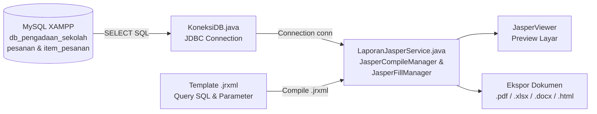

<div align="center">

# 🏫 Sistem Sales Order Pengadaan Sekolah (Dana BOS / APBD)

**Aplikasi Desktop ERP Pengadaan Barang & Jasa Sekolah Berbasis Java Swing, Maven, Hibernate ORM, Spring DAO & JasperReports v6**

[](https://openjdk.org/)
[](https://netbeans.apache.org/)
[](https://www.apachefriends.org/)
[](https://hibernate.org/)
[](https://spring.io/)
[](https://community.jaspersoft.com/)

<br />

| Identitas Proyek | Keterangan |
| :--- | :--- |
| **Perusahaan / Penyedia** | **CV. AXL SARANA MANDIRI** |
| **Direktur / Developer** | **Axl Regan Yohande** |
| **Nama Proyek Maven** | `cobamvc` (`com.mycompany.cobamvc`) |
| **Database MySQL** | `db_pengadaan_sekolah` (XAMPP `localhost:3306`) |
| **Cakupan Materi** | **Pertemuan 1 s/d Pertemuan 6 (JasperReports v6)** |

</div>

---

## 📑 Daftar Isi
- [📌 Ringkasan Proyek](#-ringkasan-proyek)
- [🗓️ Roadmap Pembelajaran (Pertemuan 1 – 6)](#️-roadmap-pembelajaran-pertemuan-1--6)
- [✨ Fitur Unggulan Aplikasi](#-fitur-unggulan-aplikasi)
- [🏗️ Arsitektur & Alur Data JasperReports](#️-arsitektur--alur-data-jasperreports)
- [📂 Struktur Proyek & Lokasi `.jrxml`](#-struktur-proyek--lokasi-jrxml)
- [🗄️ Skema Database MySQL](#️-skema-database-mysql)
- [🛠️ Teknologi & Dependency Maven](#️-teknologi--dependency-maven)
- [🚀 Panduan Instalasi & Menjalankan di NetBeans 17](#-panduan-instalasi--menjalankan-di-netbeans-17)
- [🔧 Troubleshooting Umum](#-troubleshooting-umum)

---

## 📌 Ringkasan Proyek

**Sistem Sales Order Pengadaan Sekolah** adalah aplikasi desktop Java berbasis **Apache Maven** yang dibangun untuk mendukung proses pencatatan, kalkulasi pajak otomatis (PPN 11%), manajemen data transaksi di **MySQL XAMPP**, hingga pencetakan laporan resmi dan *invoice* menggunakan **JasperReports Community v6**.

Seluruh template laporan (`.jrxml`) dikompilasi secara *runtime* langsung melalui Java (`JasperCompileManager`), sehingga proyek **dapat langsung dijalankan di Apache NetBeans 17+ tanpa perlu menginstal Jaspersoft Studio**.

---

## 🗓️ Roadmap Pembelajaran (Pertemuan 1 – 6)

| Pertemuan | Topik / Materi | Implementasi Utama | File Kunci |
| :---: | :--- | :--- | :--- |
| **1** | **Pemrograman Berorientasi Objek (OOP) & Maven** | Perancangan arsitektur Maven (`pom.xml`), implementasi 3 pilar OOP: **Encapsulation** (validasi setter/getter), **Inheritance** (`Transaksi` ➔ `Pesanan` & `Pengeluaran`), dan **Polymorphism** (*overriding* & *overloading*). | `pom.xml`, `Pesanan.java` |
| **2** | **Java Swing GUI Builder (NetBeans)** | Pembangunan antarmuka **LoginForm** menggunakan NetBeans Design Mode dan **Dashboard Main** dengan form input fleksibel (pilih katalog atau ketik bebas), auto-kalkulasi Subtotal, PPN 11%, dan Grand Total. | `LoginForm.java`, `LoginForm.form`, `Main.java` |
| **3** | **Database MySQL (XAMPP) & JDBC** | Pembuatan database `db_pengadaan_sekolah` (`pesanan`, `item_pesanan`, `pengeluaran`), koneksi `DriverManager`, serta operasi CRUD *real-time* (Simpan, Tampil `JTable`, Refresh, Hapus). | `KoneksiDB.java`, `database_pengadaan_sekolah.sql` |
| **4** | **Object-Relational Mapping (Hibernate ORM)** | Integrasi `hibernate-core` (`6.4.4.Final`), konfigurasi `hibernate.cfg.xml`, `SessionFactory` provider, serta pemetaan entity JPA (`@Entity`, `@Table`, `@Id`, `@Column`). | `hibernate.cfg.xml`, `HibernateUtil.java`, `Pesanan.java` |
| **5** | **Spring Framework & Spring DAO (`JdbcTemplate`)** | Integrasi `spring-context` & `spring-jdbc` (`6.1.6`), konfigurasi **IoC Container & Dependency Injection** (`dataSource`, `jdbcTemplate`, `pesananSpringDao`) beserta `RowMapper`. | `applicationContext.xml`, `PesananSpringDao.java` |
| **6** | **JasperReports Community v6 (Direct JDBC SQL)** | Kompilasi runtime `.jrxml` dengan **`<queryString language="SQL">`** langsung ke MySQL, filter **Semua Pesanan / Pilih Satu Pesanan**, **Invoice Resmi per Pesanan**, dan ekspor **5 format dokumen**. | `LaporanSalesOrder.jrxml`, `InvoiceSalesOrder.jrxml`, `LaporanJasperService.java` |

---

## ✨ Fitur Unggulan Aplikasi

- 🔐 **Autentikasi Login Terintegrasi MySQL:** Validasi kredensial pengguna sebelum masuk ke Dashboard utama.
- 📝 **Form Input Sales Order Fleksibel:** Nama sekolah penerima dan nama barang bisa dipilih dari *dropdown* katalog maupun diketik bebas secara kustom.
- 🧮 **Kalkulasi Pajak Otomatis (Real-Time):** Menghitung **Subtotal**, **Pajak PPN 11%**, dan **Grand Total** secara instan saat jumlah atau harga satuan berubah.
- 📊 **Laporan Rekapitulasi JasperReports v6 (Fleksibel):**
  - Mendukung mode **Semua Pesanan** (rekap lengkap) maupun **Pilih Salah Satu Pesanan** (otomatis terdeteksi dari baris yang dipilih di tabel).
  - Menghitung total pesanan (`$V{JUMLAH_BARIS}`) dan akumulasi nilai (`$V{SUM_TOTAL}`) secara native di dalam `.jrxml`.
- 🧾 **Cetak Invoice Resmi Per Pesanan:** Tombol **Cetak Invoice** memanggil `InvoiceSalesOrder.jrxml` untuk mencetak invoice resmi `INV-<NomorPesanan>` lengkap dengan rincian item dari tabel `item_pesanan`.
- 📁 **5 Format Output Sekaligus:**

| Format Output | Engine JasperReports v6 | Lokasi Hasil Output |
| :--- | :--- | :--- |
| 🖥️ **Pratinjau Layar** | `JasperViewer` | Tampil interaktif di jendela desktop (bisa zoom, print, save) |
| 📕 **PDF (`.pdf`)** | `JasperExportManager` + `OpenPDF 1.3.32` | Folder pilihan user (`JFileChooser`) / root project |
| 📗 **Excel (`.xlsx`)** | `JRXlsxExporter` + `Apache POI 5.2.5` | Folder pilihan user (`JFileChooser`) / root project |
| 📘 **Word (`.docx`)** | `JRDocxExporter` | Folder pilihan user (`JFileChooser`) / root project |
| 🌐 **HTML (`.html`)** | `JasperExportManager.exportReportToHtmlFile` | Folder pilihan user (`JFileChooser`) / root project |

---

## 🏗️ Arsitektur & Alur Data JasperReports

JasperReports **tidak menyimpan hasil laporan ke database**, melainkan **menarik data langsung dari database MySQL** melalui koneksi JDBC lalu merendernya ke layar atau file dokumen:



### Cara Kerja Query Langsung di `.jrxml`:
1. **`LaporanSalesOrder.jrxml`** menggunakan `<queryString language="SQL">` dengan filter dinamis `$P{FILTER_PESANAN}`:
   ```sql
   SELECT nomor_pesanan, nama_sekolah, DATE_FORMAT(tanggal_pesanan, '%Y-%m-%d') AS tanggal_pesanan,
          total, status_pengiriman
   FROM pesanan
   WHERE ($P{FILTER_PESANAN} IS NULL OR $P{FILTER_PESANAN} = '' OR nomor_pesanan = $P{FILTER_PESANAN})
   ORDER BY tanggal_pesanan DESC, nomor_pesanan DESC
   ```
2. **`InvoiceSalesOrder.jrxml`** menggabungkan header pesanan dan rincian barang lewat `LEFT JOIN`:
   ```sql
   SELECT p.nomor_pesanan, p.nama_sekolah, DATE_FORMAT(p.tanggal_pesanan, '%Y-%m-%d') AS tanggal_order,
          p.status_pengiriman, p.subtotal, p.nominal_ppn, p.total,
          COALESCE(i.nama_barang, p.keterangan, 'Pengadaan Barang/Jasa Sekolah (Dana BOS)') AS nama_barang,
          CASE WHEN i.id IS NOT NULL THEN CONCAT(i.qty, ' ', i.satuan) ELSE '1 Paket' END AS qty_satuan,
          COALESCE(i.harga_satuan, p.subtotal) AS harga_satuan,
          COALESCE(i.jumlah, p.subtotal) AS jumlah
   FROM pesanan p
   LEFT JOIN item_pesanan i ON i.nomor_pesanan = p.nomor_pesanan
   WHERE p.nomor_pesanan = $P{NO_PESANAN}
   ```

---

## 📂 Struktur Proyek & Lokasi `.jrxml`

Di Apache NetBeans, file `.jrxml` terletak pada node **`Other Sources ➔ src/main/resources`**:

```text
jasperreport-v6-cobamvc/
├── pom.xml                                  # Konfigurasi Maven & seluruh library (v6.21.3)
├── nbactions.xml                            # Konfigurasi tombol Run (F6) & Run File (Shift+F6)
├── database_pengadaan_sekolah.sql           # Skrip SQL database & data contoh awal
├── README.md                                # Dokumentasi utama proyek
└── src/
    └── main/
        ├── java/com/mycompany/cobamvc/
        │   ├── LoginForm.java               # Halaman login GUI NetBeans
        │   ├── LoginForm.form               # Descriptor XML Design Builder
        │   ├── Main.java                    # Dashboard utama & CRUD Sales Order
        │   ├── KoneksiDB.java               # Penyedia koneksi JDBC MySQL XAMPP
        │   ├── Pesanan.java                 # Model Entity JPA / POJO
        │   ├── HibernateUtil.java           # SessionFactory Hibernate ORM
        │   ├── PesananSpringDao.java        # Implementasi Spring JdbcTemplate DAO
        │   └── LaporanJasperService.java    # Engine compile, fill JDBC, viewer & exporter 5 format
        └── resources/                       # <--- LOKASI TEMPLATE .JRXML & KONFIGURASI
            ├── LaporanSalesOrder.jrxml      # Template Rekap Laporan Sales Order
            ├── InvoiceSalesOrder.jrxml      # Template Invoice Resmi per Pesanan
            ├── hibernate.cfg.xml            # Konfigurasi Hibernate ORM
            └── applicationContext.xml       # Konfigurasi Bean Spring Framework
```

---

## 🗄️ Skema Database MySQL

Database default: **`db_pengadaan_sekolah`** (`root` tanpa password di `localhost:3306`):

| Tabel | Fungsi | Kolom Utama |
| :--- | :--- | :--- |
| **`pesanan`** | Menyimpan header transaksi Sales Order | `id`, `nomor_pesanan` *(PK)*, `tanggal_pesanan`, `keterangan`, `nama_sekolah`, `subtotal`, `nominal_ppn`, `total`, `status_pengiriman` |
| **`item_pesanan`** | Menyimpan rincian barang tiap Sales Order | `id` *(AI PK)*, `nomor_pesanan` *(FK)*, `nama_barang`, `qty`, `satuan`, `harga_satuan`, `jumlah` |
| **`pengeluaran`** | Menyimpan biaya operasional & logistik | `id` *(PK)*, `kode_transaksi`, `tanggal`, `keterangan`, `nominal`, `kategori` |

---

## 🛠️ Teknologi & Dependency Maven

Seluruh dependency dikelola otomatis oleh Maven di `pom.xml` dengan target kompilasi `<release>17</release>`:

- `com.mysql:mysql-connector-j:8.3.0` — Driver JDBC MySQL / MariaDB
- `com.formdev:flatlaf:3.4` — *Look and Feel* Swing modern
- `org.hibernate.orm:hibernate-core:6.4.4.Final` — Hibernate ORM / JPA
- `org.springframework:spring-context:6.1.6` & `spring-jdbc:6.1.6` — Spring IoC & Spring DAO
- `net.sf.jasperreports:jasperreports:6.21.3` — JasperReports Community Engine v6
- `com.github.librepdf:openpdf:1.3.32` — Generator ekspor PDF
- `org.apache.poi:poi-ooxml:5.2.5` — Generator ekspor Excel (`.xlsx`)
- `org.eclipse.jdt:ecj:3.33.0` — Compiler runtime `.jrxml` yang stabil di JDK 17, 21, & 22

---

## 🚀 Panduan Instalasi & Menjalankan di NetBeans 17

### 1. Aktifkan Database MySQL (XAMPP)
1. Buka **XAMPP Control Panel**, lalu klik **Start** pada **Apache** dan **MySQL**.
2. Buka `http://localhost/phpmyadmin`.
3. Buat database baru bernama **`db_pengadaan_sekolah`**.
4. Masuk ke tab **Import**, pilih file **`database_pengadaan_sekolah.sql`**, lalu klik **Import / Go**.

### 2. Buka & Build Proyek di Apache NetBeans
1. Pastikan lokasi folder proyek **tidak mengandung spasi** *(contoh benar: `C:\Users\ACER\Desktop\jasperreport-v6-cobamvc`)*.
2. Buka Apache NetBeans 17 ➔ **File** ➔ **Open Project...** ➔ pilih folder proyek.
3. Klik kanan nama project ➔ pilih **Clean and Build** *(tunggu hingga muncul `BUILD SUCCESS`)*.

### 3. Jalankan Aplikasi
- **Cara Utama — Run Project (`F6`):**
  1. Klik project di panel kiri, lalu tekan **`F6`** (atau klik ikon **Play hijau ▶** di toolbar).
  2. Pada jendela **Login**, masukkan kredensial:
     - **Username:** `admin`
     - **Password:** `password`
  3. Di **Dashboard Utama**:
     - Klik **`📊 Laporan Jasper v6`** ➔ pilih **Semua Pesanan** atau **Pilih Salah Satu Pesanan** ➔ pilih format output (**JasperViewer / PDF / Excel / Word / HTML**).
     - Klik salah satu baris pesanan di tabel ➔ klik **`📄 Cetak Invoice`** ➔ pilih format output untuk mencetak invoice resmi.
- **Cara Alternatif — Uji Langsung Generator Laporan (`Shift + F6`):**
  - Klik kanan `LaporanJasperService.java` ➔ pilih **Run File** (`Shift + F6`).
  - Sistem akan otomatis membuat file `Laporan_Sales_Order_AXL.pdf`, `.xlsx`, `.docx`, `.html` di folder root proyek sekaligus membuka jendela `JasperViewer`.

---

## 🔧 Troubleshooting Umum

- **Menu `Run File (Shift+F6)` berwarna abu-abu di NetBeans 17 + JDK 22:**  
  Gunakan **`Run Project (F6)`** di project root, atau aktifkan *Compile on Save* lewat **Klik kanan Project ➔ Properties ➔ Build ➔ Compile ➔ centang Compile on Save**.
- **Error `Communications link failure`:**  
  Pastikan module **MySQL** di XAMPP sudah berstatus **Running** (hijau) pada port `3306` dan database `db_pengadaan_sekolah` sudah dibuat.
- **Build lambat pada Clean & Build pertama:**  
  Wajar karena Maven mengunduh dependency JasperReports, Hibernate, Spring, dan POI ke folder lokal `.m2`. Build berikutnya akan berjalan jauh lebih cepat.

---

<div align="center">

Dikembangkan oleh **Axl Regan Yohande** — **CV. AXL SARANA MANDIRI**  
*Praktikum Pemrograman Berorientasi Objek & Pengembangan Aplikasi Bisnis Java (Pertemuan 1–6)*

</div>
